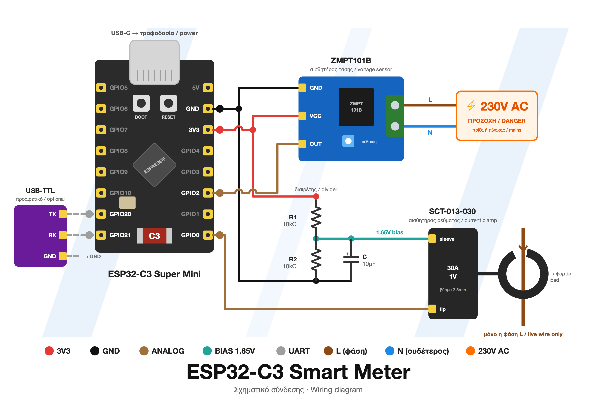

# Smart Meter — ESP32-C3

[🇬🇷 Ελληνικά](#-ελληνικά) · [🇬🇧 English](#-english)

> ⚠️ **Προσοχή / Warning:** Το κύκλωμα συνδέεται στα **230V AC**. Δούλευε πάντα με το κύκλωμα αποσυνδεδεμένο από το δίκτυο, με μόνωση, κουτί και ασφάλεια.
> The circuit connects to **230V AC mains**. Always work with it disconnected, use insulation, an enclosure and a fuse.



---

## 🇬🇷 Ελληνικά

### Τι είναι

Ένας **έξυπνος μετρητής ρεύματος** για το σπίτι, βασισμένος στο **ESP32-C3 Mini**. Μετράει σε πραγματικό χρόνο την κατανάλωση ηλεκτρικής ενέργειας και στέλνει τις μετρήσεις μέσω **WiFi / MQTT**, με αυτόματη αναγνώριση από το **Home Assistant**.

Υπολογίζει επίσης το **κόστος** της κατανάλωσης με τις **ωριαίες τιμές χονδρικής (day-ahead) της Ελλάδας** από την πλατφόρμα ENTSO-E.

### Τι μετράει

| Μέγεθος | Μονάδα |
|---|---|
| Τάση (Vrms) | V |
| Ρεύμα (Irms) | A |
| Πραγματική ισχύς | W |
| Φαινόμενη ισχύς | VA |
| Συντελεστής ισχύος (cos φ) | – |
| Συνολική ενέργεια / ενέργεια ημέρας | kWh |
| Τιμή κιλοβατώρας | €/kWh |
| Κόστος ώρας / κόστος ημέρας | € |

### Υλικά

- **ESP32-C3 Mini**
- **ZMPT101B** — αισθητήρας τάσης → `GPIO2`
- **SCT-013-030** (30A/1V) — αισθητήρας ρεύματος (clamp) → `GPIO0`
  - διαιρέτης τάσης 10k/10k (bias 1.65V) και πυκνωτής 10µF από το μέσο του διαιρέτη στη γείωση

Δες το [σχηματικό σύνδεσης](docs/wiring.png) στην αρχή της σελίδας.

### Εγκατάσταση

1. Εγκατέστησε το **Arduino IDE** (ή το arduino-cli) με το πακέτο πλακετών **esp32** και επίλεξε πλακέτα `ESP32C3 Dev Module`, με `USB CDC On Boot: Enabled`.
2. Από το Library Manager εγκατέστησε τη βιβλιοθήκη **PubSubClient** (Nick O'Leary).
3. Στον φάκελο `smart_meter/` αντέγραψε το `secrets.example.h` σε **`secrets.h`** και συμπλήρωσε τα WiFi, MQTT και (προαιρετικά) το ENTSO-E token.
4. Ανέβασε τον κώδικα στο ESP32 και άνοιξε τον Serial Monitor στα **115200 baud**.

### Βαθμονόμηση

Στην αρχή του `smart_meter.ino`:

- **`VCAL`** — διόρθωσε με πολύμετρο: `VCAL_νέο = VCAL_παλιό × (V πολυμέτρου / V σειριακής)`
- **`ICAL`** — 30.0 για SCT-013-030, 10.0 για SCT-013-010
- **`PHASE_SHIFT` / `PHASECAL`** — διόρθωση φάσης ώστε cos φ ≈ 1.00 με ωμικό φορτίο (π.χ. βραστήρας)
- **`INVERT_CURRENT`** — βάλε `1` αν η ισχύς βγαίνει αρνητική (το clamp είναι ανάποδα)

### MQTT

Οι μετρήσεις δημοσιεύονται κάθε 5 δευτερόλεπτα στο topic `smartmeter/<id>/state` ως JSON:

```json
{"v":230.1,"i":1.234,"p":270.5,"s":284.0,"pf":0.95,"e":12.3456,"price":0.1550,"ed":3.2100,"cost_h":0.0420,"cost_d":0.4975,"rssi":-60}
```

### Τιμές ENTSO-E (προαιρετικό)

Φτιάξε δωρεάν λογαριασμό στο <https://transparency.entsoe.eu> και ζήτα «Restful API access» με email στο transparency@entsoe.eu. Χωρίς token χρησιμοποιείται σταθερή τιμή (`FALLBACK_PRICE`).

---

## 🇬🇧 English

### What it is

A **home energy monitor** built on the **ESP32-C3 Mini**. It measures electricity consumption in real time and publishes the readings over **WiFi / MQTT**, with **Home Assistant** auto-discovery.

It also calculates the **cost** of your consumption using **Greek hourly day-ahead wholesale prices** from the ENTSO-E transparency platform.

### What it measures

| Quantity | Unit |
|---|---|
| Voltage (Vrms) | V |
| Current (Irms) | A |
| Real power | W |
| Apparent power | VA |
| Power factor (cos φ) | – |
| Total energy / today's energy | kWh |
| Electricity price | €/kWh |
| Cost this hour / cost today | € |

### Hardware

- **ESP32-C3 Mini**
- **ZMPT101B** — voltage sensor → `GPIO2`
- **SCT-013-030** (30A/1V) — current clamp → `GPIO0`
  - 10k/10k voltage divider (1.65V bias) with a 10µF capacitor from the divider midpoint to GND

See the [wiring diagram](docs/wiring.png) at the top of the page.

### Setup

1. Install the **Arduino IDE** (or arduino-cli) with the **esp32** board package and select `ESP32C3 Dev Module`, with `USB CDC On Boot: Enabled`.
2. Install the **PubSubClient** library (Nick O'Leary) from the Library Manager.
3. In the `smart_meter/` folder, copy `secrets.example.h` to **`secrets.h`** and fill in your WiFi, MQTT and (optionally) ENTSO-E token.
4. Upload the sketch and open the Serial Monitor at **115200 baud**.

### Calibration

At the top of `smart_meter.ino`:

- **`VCAL`** — adjust with a multimeter: `VCAL_new = VCAL_old × (V_multimeter / V_serial)`
- **`ICAL`** — 30.0 for SCT-013-030, 10.0 for SCT-013-010
- **`PHASE_SHIFT` / `PHASECAL`** — phase correction so cos φ ≈ 1.00 with a resistive load (e.g. a kettle)
- **`INVERT_CURRENT`** — set to `1` if power reads negative (clamp mounted backwards)

### MQTT

Readings are published every 5 seconds to `smartmeter/<id>/state` as JSON (see the example above).

### ENTSO-E prices (optional)

Create a free account at <https://transparency.entsoe.eu> and request "Restful API access" by emailing transparency@entsoe.eu. Without a token, a fixed price (`FALLBACK_PRICE`) is used.
