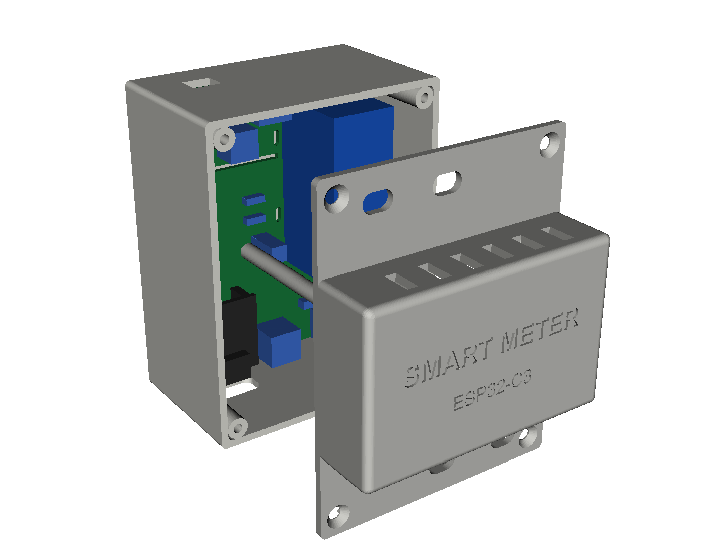
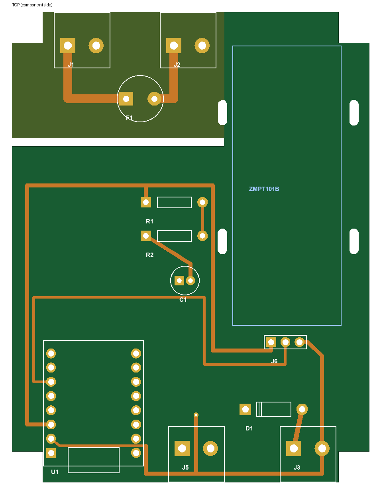
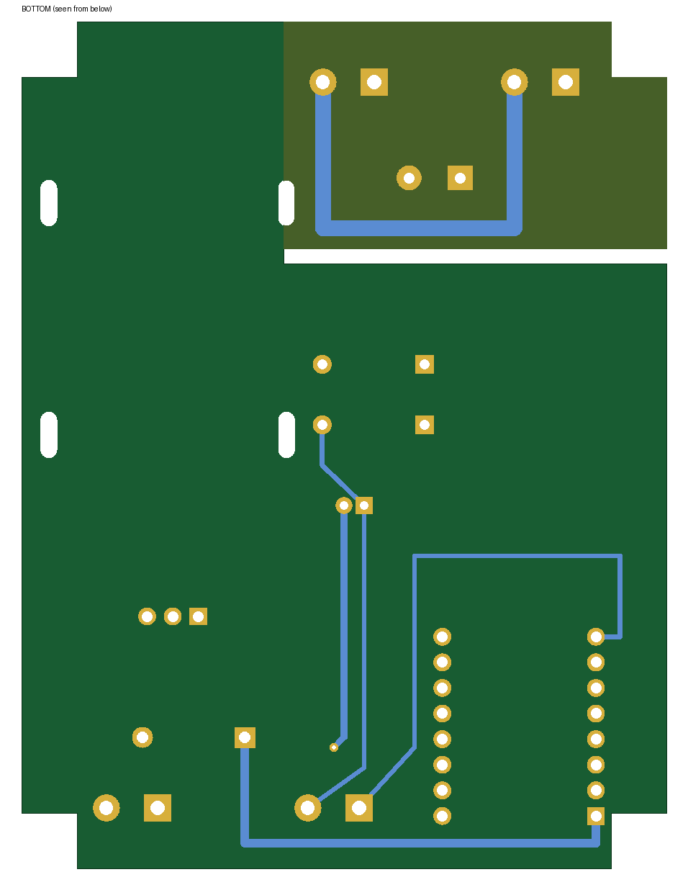

# Hardware — PCB + κουτί ράγας DIN / PCB + DIN-rail enclosure

> ⚠️ **230V AC.** Η εγκατάσταση σε ηλεκτρικό πίνακα πρέπει να γίνει από ηλεκτρολόγο ή με τον γενικό διακόπτη **κατεβασμένο**. Βάλε ξεχωριστή μικροαυτόματη ασφάλεια (π.χ. 2A) για τη γραμμή που τροφοδοτεί τον μετρητή.
> Installation in a distribution board should be done by an electrician, with the main switch **off**.



## Αρχεία / Files

| Αρχείο | Τι είναι |
|---|---|
| `enclosure/smart_meter_base.stl` | Βάση με κούμπωμα ράγας DIN — για εκτύπωση |
| `enclosure/smart_meter_cover.stl` | Καπάκι με «μύτη» 45mm — για εκτύπωση |
| `enclosure/*.step` | Τα ίδια σε STEP, για **Fusion** (File → Open / Upload) |
| `enclosure/smart_meter_assembly.step` | Κουτί + εικονική PCB, για έλεγχο ότι χωράνε |
| `pcb/smart_meter.brd` | **Η PCB, έτοιμη και δρομολογημένη** — ανοίγει στο **Fusion Electronics** |
| `pcb/pcb_top.png`, `pcb/pcb_bottom.png` | Προεπισκόπηση των δύο πλευρών |
| `pcb/placement.png` | Θέσεις εξαρτημάτων (mm) + συνδέσεις |
| `pcb/pcb_outline.dxf` | Μόνο το περίγραμμα της PCB (αν θες να τη σχεδιάσεις από την αρχή) |
| `layout.py` | Όλες οι διαστάσεις σε ένα σημείο |
| `enclosure.py`, `pcb_gen.py`, `placement.py` | Scripts που ξαναφτιάχνουν τα αρχεία |

## Κουτί / Enclosure

- **4 θέσεις DIN** (70 × 90 mm), βάθος 45 mm + μύτη 18 mm (σύνολο 63 mm) — όπως ένας ασφαλειοδιακόπτης.
- **Κούμπωμα ράγας TS35:** σταθερό άγκιστρο πάνω, ελατήριο κάτω. Κρέμασέ το από πάνω και πίεσε το κάτω μέρος. Για να το βγάλεις, τράβα τη λαβή κάτω με κατσαβίδι.
- **Πάνω:** άνοιγμα για τα καλώδια 230V (J1). **Κάτω:** κλέμα 5V (J3), κλέμα δαγκάνας SCT-013 (J5), **USB-C** για προγραμματισμό.
- Τρύπες στους «ώμους» του καπακιού για το κατσαβίδι των κλεμών.
- 4 βίδες **M3 × 12** φρεζάτες (αυτοδιάτρητες σε οπή 2.6 mm) κλείνουν το καπάκι. Η PCB πατάει σε ράφια και τη συγκρατούν δύο κολονάκια του καπακιού.

**Εκτύπωση:** PETG (όχι PLA — ο πίνακας ζεσταίνεται), 0.2 mm, 4 περίμετροι, 25% infill.
Βάση: με την ανοιχτή πλευρά **προς τα κάτω** (το κούμπωμα DIN βγαίνει χωρίς υποστηρίγματα). Καπάκι: με τη μύτη **προς τα πάνω**.

## PCB (64 × 84 mm, 2 στρώσεις)

| Πάνω πλευρά / Top | Κάτω πλευρά / Bottom |
|---|---|
|  |  |

Η πλακέτα είναι **έτοιμη και δρομολογημένη** στο `pcb/smart_meter.brd` (μορφή EAGLE, που ανοίγει το Fusion).

- **Πάνω (πορτοκαλί ζώνη) — 230V:** κλέμα L/N (J1) → ασφάλεια F1 → κλέμα J2 → κοντά καλώδια προς την κλέμα AC του ZMPT101B. Γραμμές 1.5 mm, απόσταση ≥ 3 mm μεταξύ L και N, και **σχισμή απομόνωσης** προς τη χαμηλή τάση (ελάχιστη απόσταση 230V ↔ χαμηλή τάση: 9.4 mm).
- **ZMPT101B:** το module κάθεται πάνω στην πλακέτα (χωρίς χαλκό από κάτω) με δεματικό, και συνδέεται με dupont στο J6 (VCC, OUT, GND). Τροφοδοτείται από **3V3** ώστε η έξοδός του να μην ξεπερνά ποτέ τα 3.3V του ADC.
- **ESP32-C3 Super Mini:** σε θηλυκά headers, USB-C προς τα κάτω. Χωρίς χαλκό κάτω από την κεραία.
- **Κάτω άκρη:** κλέμα **5V** (J3, μέσω διόδου D1) και κλέμα για τη **δαγκάνα SCT-013** (J5: tip, sleeve).

Ο έλεγχος που έτρεξε το `pcb_gen.py`: αποστάσεις ≥ 0.2 mm μεταξύ nets, ≥ 3 mm για τα 230V, ≥ 0.4 mm από την άκρη, τίποτα στις απαγορευμένες περιοχές, όλα τα nets συνδεδεμένα.

### Άνοιγμα στο Fusion και παραγγελία

1. Fusion → **File → Open → Open from my computer** → διάλεξε το `pcb/smart_meter.brd`.
2. Τρέξε **DRC** (Rules DRC/ERC → DRC). Αν θες, πρόσθεσε GND polygon στη ζώνη χαμηλής τάσης (όχι στη ζώνη 230V — έχει ήδη περιοχές απαγόρευσης).
3. **Manufacturing → CAM Processor** → template **JLCPCB 2-layer** → Process Job → αποθηκεύεται ένα .zip με τα Gerbers.
4. Ανέβασε το .zip στο jlcpcb.com (1.6 mm, HASL, 5 τεμάχια).

> Η PCB δεν έχει σχηματικό (.sch) — μόνο board. Αν το Fusion ζητήσει σχηματικό, συνέχισε μόνο με το board. Τα footprints είναι δικά μας (βιβλιοθήκη `smart_meter` μέσα στο αρχείο). Αν θες, μπορείς να αντικαταστήσεις το U1 με το footprint *ESP32-C3 SuperMini_TH* του SnapEDA — τα pads πρέπει να πέσουν στις ίδιες θέσεις.

### Λίστα υλικών / BOM

| Ref | Τεμ. | Εξάρτημα | Σημείωση |
|---|---|---|---|
| U1 | 1 | ESP32-C3 Super Mini | σε 2× θηλυκά header 1x8 (2.54mm), αφαιρείται |
| — | 2 | Θηλυκό header 1x8, 2.54mm, ύψος 8.5mm | για το U1 |
| — | 1 | ZMPT101B module | το ίδιο που έχεις (VCAL μένει ίδιο) |
| J1, J2, J3, J5 | 4 | Κλέμα 2 θέσεων 5.08mm (Phoenix MKDS 1,5/2-5,08 ή KF128) | J1 230V, J2 → ZMPT AC, J3 5V, J5 δαγκάνα |
| F1 | 1 | Ασφάλεια TR5 100mA slow (T) | + βάση TR5 αν θες να αλλάζει |
| J6 | 1 | Αρσενικό header 1x3 2.54mm | → header του ZMPT με dupont |
| R1, R2 | 2 | 10kΩ 1/4W | διαιρέτης bias |
| C1 | 1 | 10µF 16V ηλεκτρολυτικός, Ø5, βήμα 2mm | |
| D1 | 1 | 1N5819 Schottky | 5V κλέμα → ESP, ώστε USB και τροφοδοτικό να μη «συγκρούονται» |
| — | 1 | Δεματικό 2.5mm | συγκρατεί το ZMPT module |
| — | 4 | Βίδα M3 × 12 φρεζάτη | καπάκι |
| — | 3 | Καλωδιάκι 0.75mm² ~5cm + 3 dupont | J2 → AC του module, J6 → header του module |

### Τροφοδοσία 5V

Το J3 θέλει **σταθεροποιημένα 5V** (≥ 300mA), π.χ. από τροφοδοτικό ράγας DIN 5V (Mean Well HDR-15-5). Μη συνδέεις ταυτόχρονα καλώδιο USB και τροφοδοτικό χωρίς το D1.

## ⚠️ Μέτρησε πριν παραγγείλεις / Measure before ordering

Οι διαστάσεις του **ESP32-C3 Super Mini** και του **ZMPT101B module** διαφέρουν λίγο ανάμεσα σε κατασκευαστές. Με παχύμετρο έλεγξε:

- Απόσταση ανάμεσα στις δύο σειρές pins του ESP32 → πρέπει να είναι **15.24 mm** (`ESP_COL_X` στο `layout.py`).
- Διαστάσεις του ZMPT101B module → περίπου **49.5 × 19.5 mm**, ύψος ≤ 26 mm (`ZMPT_ZONE`, `ZMPT_HEIGHT`).

Αν κάτι διαφέρει, άλλαξε το `layout.py` και ξανατρέξε τα scripts (χρειάζεται `pip install cadquery shapely pillow`):

```bash
python enclosure.py && python pcb_gen.py && python placement.py
```

### Δαγκάνα SCT-013 σε κλέμα

Κόψε το βύσμα 3.5mm της SCT-013. Από τα δύο καλώδια, αυτό που πήγαινε στη μύτη (**tip**) μπαίνει στο **TIP** της J5 και το άλλο (**sleeve**) στο **SLV**. Αν δεν είσαι σίγουρος ποιο είναι ποιο, μέτρησε με πολύμετρο πριν το κόψεις.
